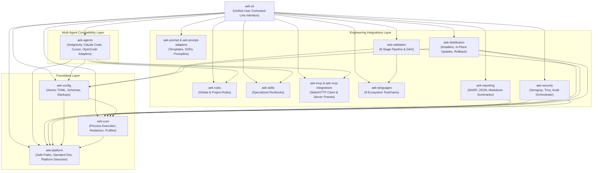
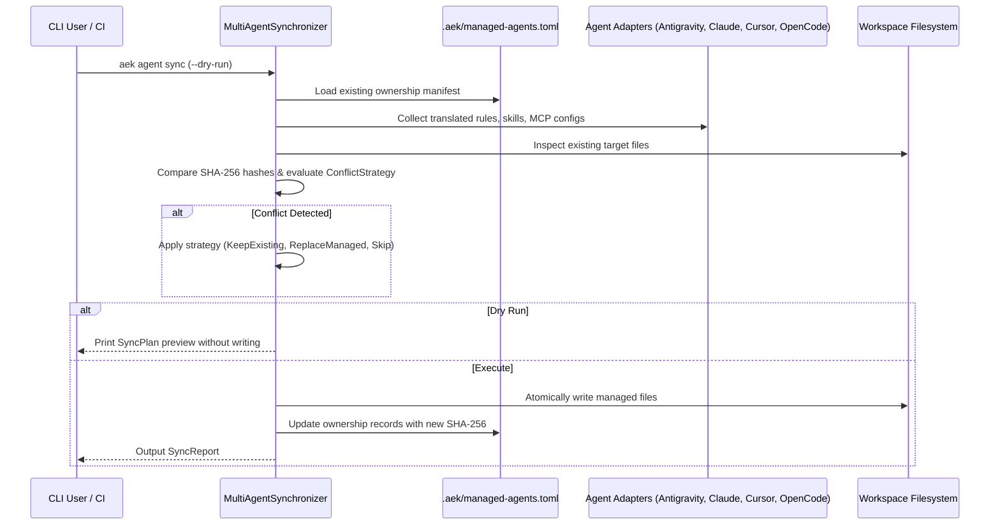

# AEK System Architecture Specification — v0.1.0

## 1. System Overview

**Antigravity Engineering Kit (AEK)** is a high-performance, modular, cross-platform engineering toolkit written in Rust. AEK provides a foundational platform layer, an execution engine, a configuration manager, MCP client framework, multi-language toolchain management, prompt optimization, automated validation, security scanning, cross-platform lifecycle management, and universal multi-agent adapters.

---

## 2. Workspace Crate Architecture

The AEK workspace comprises 16 strictly bounded Rust crates:

| Crate | Responsibility | Core Invariants |
| :--- | :--- | :--- |
| `crates/aek-platform` | OS, architecture detection, standard directory resolution, path traversal defense. | Zero elevation required; strict `is_safe_subpath` enforcement. |
| `crates/aek-core` | Safe subprocess execution engine (`SafeCommand`), secret redaction, resource profile tiers (`LIGHT`, `ENGINEERING`, `FULL`). | Argument arrays only; zero shell string interpolation. |
| `crates/aek-config` | Strongly-typed TOML models (`AekConfig`), atomic file writes, backup & rollback engine. | Unknown-field rejection; atomic temporary file replacement. |
| `crates/aek-rules` | Global and project rules registry, tiered precedence resolution, token budget estimation. | 24 KB size ceiling per rule; markdown frontmatter validation. |
| `crates/aek-skills` | Agent skill discovery, parsing, progressive disclosure, project-aware confidence scoring. | Strict YAML frontmatter verification; dry-run installation. |
| `crates/aek-agents` | Universal agent adapters (Antigravity, Claude Code, Cursor, OpenCode), capability matrix, conflict-safe synchronization. | Cross-platform translation; SHA-256 ownership tracking via `.aek/managed-agents.toml`. |
| `crates/aek-mcp` | Reusable Model Context Protocol (MCP) JSON-RPC 2.0 client engine over Stdio and Streamable HTTP. | Request timeout supervision; permission boundary enforcement. |
| `crates/aek-mcp-integrations` | Official MCP server configurations (Context7, GitHub, Playwright, Sequential Thinking, Filesystem). | Zero hardcoded tokens; environment-based secret binding. |
| `crates/aek-languages` | Toolchain detection, compiler diagnostics, and project inspection across 8 ecosystems. | Non-destructive detection; platform-aware binary resolution. |
| `crates/aek-validation` | 8-stage verification pipeline (Formatting -> Linting -> TypeCheck -> Build -> Test -> Security), incremental Git diff analysis, quality gates. | Deterministic DAG ordering; fail-fast or collect-all modes. |
| `crates/aek-security` | Multi-scanner orchestration (Semgrep SAST, Trivy CVE scan, native dependency auditors). | Graceful degradation when external binaries are not on PATH. |
| `crates/aek-reporting` | Structured terminal badges, machine-readable JSON, OASIS SARIF v2.1.0 output, GitHub Markdown job summaries. | Standard SARIF schema adherence. |
| `crates/aek-distribution` | Cross-platform installation paths, release manifest verification, atomic in-place updates, rollback snapshots, clean uninstallation. | User-space operation; SHA-256 checksum validation. |
| `crates/aek-prompt` | Prompt template engine, typed variable binding, version control with content hashing, injection resistance. | Deterministic variable substitution; strict Jinja delimiters. |
| `crates/aek-prompt-adapters` | External prompt optimization bridges (Prompt Optimizer, Stanford DSPy, Promptfoo). | Optional dependencies; structured error reporting. |
| `crates/aek-cli` | Clap-based command-line interface, argument routing, user presentation. | Exit codes: 0 = success, 1 = failure, 2 = usage error. |

---

## 3. Layering & Dependency Invariants

1. **Unidirectional Dependencies**:
   - `aek-cli` depends on domain crates (`aek-agents`, `aek-rules`, `aek-validation`, etc.).
   - Domain crates depend on foundational crates (`aek-core`, `aek-config`, `aek-platform`).
   - Foundational crates NEVER depend on domain crates or `aek-cli`.
2. **Subprocess Isolation**:
   - Subprocesses are spawned using `std::process::Command` with typed arguments array.
   - No command is passed to `cmd.exe /c` or `sh -c`.
3. **Filesystem Containment**:
   - All destination paths are verified with `sanitize_relative_path` and `is_safe_subpath`.
   - Path traversals (e.g. `../../etc/cron.d`) are rejected with `PlatformError::SecurityViolation`.
4. **Crash-Safe Mutations**:
   - Every file modification writes to `<path>.tmp.<pid>`, flushes to disk, and executes atomic rename.
   - Rollback manifests are persisted prior to in-place binary upgrades.

---

## 4. Multi-Agent Synchronization Flow

---

## 5. Security Architecture & Threat Model

### Trust Boundaries
1. **Host Environment**: AEK runs as the executing user. It does not require or seek root/administrator privileges.
2. **External Binaries**: External compilers and scanners (e.g., `cargo`, `rustc`, `semgrep`, `trivy`) are assumed to be trusted by the user, but AEK isolates their invocation using arguments arrays and bounded timeouts.
3. **AI Agent Workspaces**: Target agent directories (`.cursor/`, `.claude/`, `.opencode/`, `.gemini/`) are treated as managed output locations. Existing user files are preserved unless explicitly marked for management by AEK.
4. **Prompt Security**: User input variables in prompt templates are escaped and validated against control character injections.
